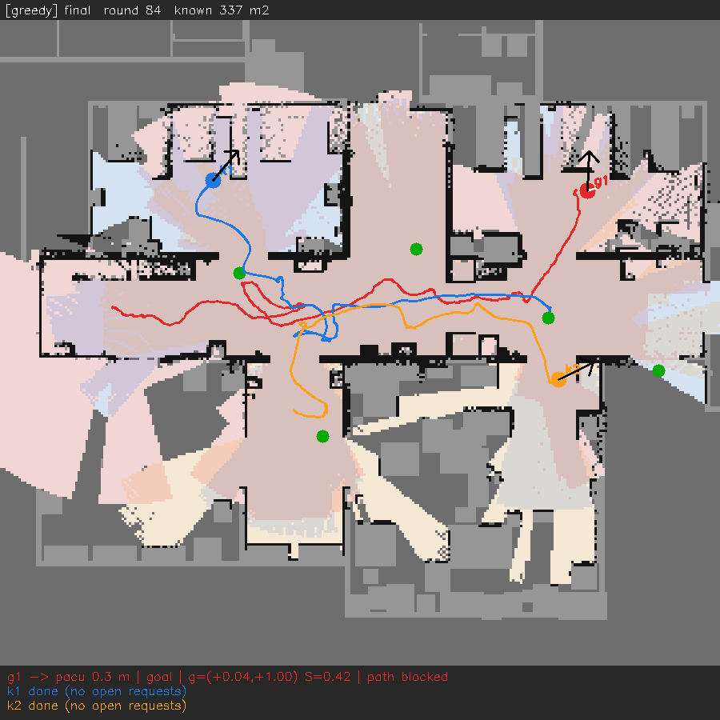
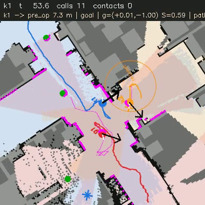
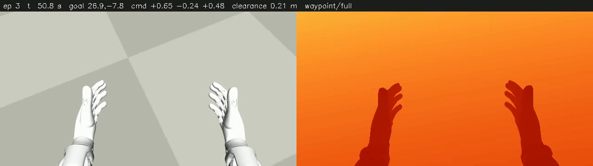

# Multi-agent mapping and motion planning with one physics-informed model
{: .fs-8 }

Unitree G1 humanoids start where you choose in the WardZero hospital (MuJoCo or Isaac Sim 6.2) and must reach goals
you choose, in a building they have never seen. **One** neural network learns the arrival-time field of the hospital
from all the robots' lidar, online, and plans every robot's motion.
{: .fs-5 .fw-300 }

[Get started](getting-started){: .btn .btn-primary .mr-2 } [All commands](commands){: .btn .mr-2 } [How it works](method){: .btn }

---


*The shared map at the end of a 3-agent MuJoCo run. Cells are tinted by the robot that mapped them; the lines are
each robot's trajectory. Grey is the hospital, shown for reference only.*

## What it does

- **One physics-informed model.** Active Neural Time Fields ([paper](https://arxiv.org/abs/2410.09883), Alg. 1) is
  trained on lidar alone to satisfy the eikonal equation. The multi-agent mantf network adds the other agent as an
  input, so the time field bends around other robots and people.
- **Centralised, round-robin calls.** Agents call the model in turn (1, 2, ..., N, 1, ...). On its call an agent
  shares its x, y, lidar and plan. The model trains on that frame and returns the agent's next viewpoint, the
  direction `(gx, gy) = -grad T`, and its path (paper Eq. 11).
- **Mapping and motion planning together.** A shared 2-D map and 3-D voxel map grow from every robot's lidar.
  Frontiers are explored with the model's arrival time. Once a goal is reachable through mapped space, the robot
  plans to it on the learned field.
- **Two cases.** `cooperative`: arrival time + goal distance + the other agents' shared plans. `greedy`: straight for
  the agent's own goal.
- **Any number of agents.** 1 (the paper's setting) to 10 or more, each with its own start and goal.
- **People** walk through the hospital as dynamic obstacles. In Isaac they are animated characters.
- **Everything is recorded:** every model call, every agent's lidar, trajectory, contacts, coverage and its own-view
  video of each goal, the G1's head-camera video, and the 2-D and 3-D maps.

| own view of a kinematic G1 | head camera of the simulated G1 |
|---|---|
|  |  |

## Quick start

```bash
pixi install && pixi run build && pixi run setup     # once; then open a new shell
mg1 case cooperative mujoco                           # 3 G1s, MuJoCo, results in runs/mujoco/cooperative/...
```

See [Getting started](getting-started) for requirements, and [Commands](commands) for everything else.
