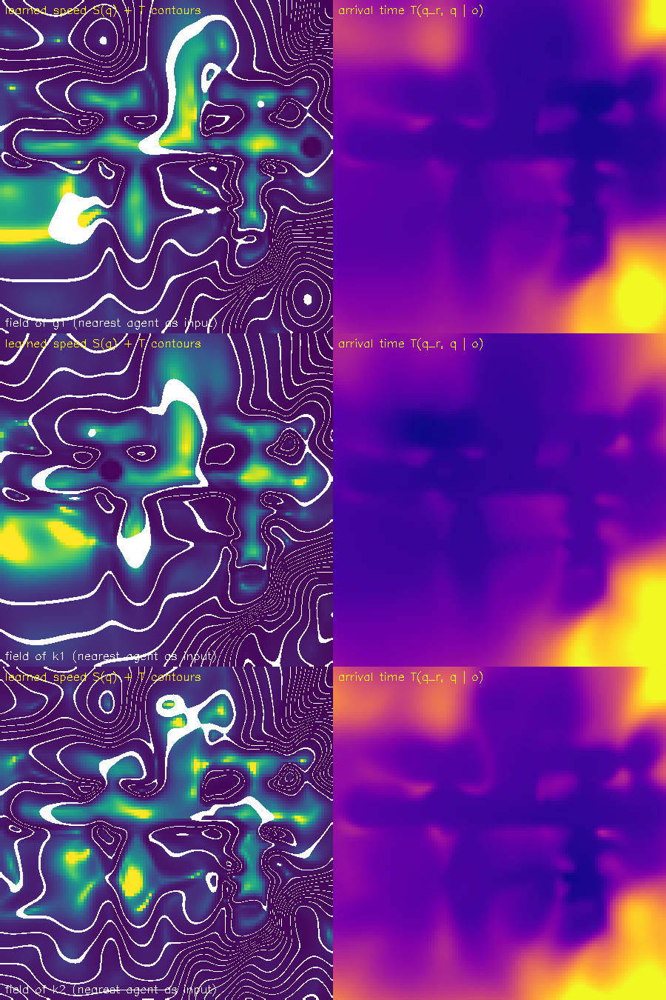
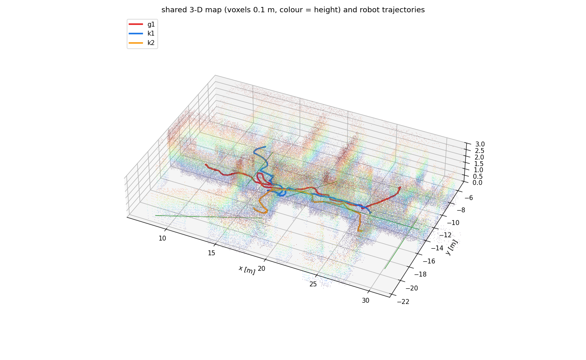

# Method: one physics-informed model for multi-agent mapping and motion planning

## Goal

Several Unitree G1 humanoids start at chosen places in a hospital they have never seen, and each must reach its own
goal. They map the building and plan their motion with **one** physics-informed neural network (PINN):

- the Active Neural Time Fields method (Liu, Ni, Qureshi, *Active Neural Time Fields for Physics-Informed Robot
  Mapping and Planning*, arXiv 2410.09883; `references/2410.09883v2.pdf`), single-agent in the paper;
- extended to several agents and moving people by the mantf model (`mantf/models/model_igibson_n.py`, branch
  `fullstack`).

The agents share their x, y and their plans with that single model, and the model uses them when it plans for each
agent.

## The model (paper + mantf)

The network predicts the arrival time between two points `q_s`, `q_g` given another agent at `o`:

```
T(q_s, q_g | o) = log(tau(q_s, q_g | o))^2 * |q_s - q_g|                    (factorised time, paper Eq. 5-6)
tau = sigmoid(y_walls(q_s, q_g) + Delta(q_s, q_g, o)) / e                   (mantf: agent branch Delta, starts at 0)
```

It is trained only from the agents' own lidar (paper Alg. 1):

```
S*(q)       = clip(d(q) - r_robot, dmin, dmax) / dmax                       (expert speed, Eq. 4; d = distance to the
                                                                             nearest scanned surface)
S*_agent(q) = min(S*(q), clip(|q - o| - 2r, dmin, dmax) / dmax)             (mantf: the other agent slows the field)
S(q)        = 1 / |grad_q T|                                                (learned speed)
L           = ( sqrt(S*' * |grad T|) - 1 )^2                                (eikonal loss, Eq. 12; S*' = mantf transform)
```

Training uses AdamW (lr 5e-4, weight decay 0.1), batches of 2000 and j = 50 epochs per new frame, on
`B_j = sample(M) ∪ frame` (memory M of earlier frames, mantf `randomize_data`). M keeps the most recent 600 frames, so
long runs fit in GPU memory; the paper keeps all of them. Half of each batch gets a random
other agent near one end (mantf `augment_others`), so the model learns agents everywhere.

Planning (paper Eq. 11): bidirectional gradient descent of T from both ends (mantf `predict_trajectory2`). The first
step of that descent, `(gx, gy) = -grad_q T(q, target | o) / |.|`, is the direction in which the agent should move.

## n agents as input, and moving people (mantf `fullstack`)

The network takes the **set** of other agents: each row of a frame carries the K = 6 robots and people nearest to its
start point, every one read by the same branch and max-pooled (mantf nagents), so one network serves any count.
Fewer than K are padded by repeating the nearest, which changes neither the pooled `Delta` nor the speed ceiling
`min_o clip(|q - o| - 2r)`. Plans get the K nearest people (now) and robots (where their shared plans put them in 1 s).

### Moving people: SE(2) tracker

Each agent has its own tracker (mantf aniANTF, `models/se2_dynamic.py`). At each of its calls the people are
ray-cast as 0.25 m discs into the agent's walls-only scan at t - 2g, t - g and t from its current origin
(g = 0.3 s): the tracker's three-scans-from-one-pose protocol, so only what moved shortens a ray. Rays shorter by
more than 0.10 m are split into bodies; two centroids under one baseline give a twist `xi = (c1 - c0)/(t1 - t0)`.

```
lam(x)  = 0.8 max(0, 1 - clr(x)/0.5 m),  clr = distance to the body's swept tube over the next 1 s
A       = I - lam u u^T,                 u = direction of the body's twist
L, S, Gradient use <a, A b> = <a, b> - lam <a, u><b, u>   (lam = 0: the isotropic field exactly)
S*(q)   = min(S*(q), clip(swept clearance - r_robot, dmin, dmax)/dmax)        (swept-tube labels)
```

So travel along a person's path is dear and crossing it is cheap, and ground a person is walking into is slow
before they get there. The cost map (`costmap.mp4`, `maps/*_costmap.png`) shows `lam` over the shared map with each
tracker's bodies and twists against the true people.

### Clocks and metrics per run (`results.json`)

| metric | how |
|---|---|
| SE(2) tracking accuracy | every fresh body vs its nearest true person: centroid, twist and heading error (`tracking_log.csv`) |
| time to complete / to reach | episode sim time per agent; the last one when all reached |
| collision-avoidance time | sim time the guard changed an agent's command with another body within 2 m |
| in-tube time | sim time an agent spent where `lam > 0.05` |
| time to next position | from a call until the agent is within 0.35 m of the point 1 m along its new plan |
| exploration time | until the shared map holds 90 % of its final area (`coverage_log.csv`) |
| clock per call | track, rows, train, plan, total (`train_log.csv`) |

## Centralised round-robin calls (multi-agent)

One process holds the model and the shared maps. The agents call it in turn, 1, 2, ..., N, 1, ...

```
call k, agent i = k mod N:
  agent i SHARES  x_i, y_i, lidar_i and its current plan (viewpoint, path)
  shared map      <- lidar_i  (2-D log-odds grid, seen_by[i]; 3-D voxel map)
                     returns that land on a known agent are dropped: agents are the model's input, not walls
  frame_i         <- N rays x m stratified samples on lidar_i, S* (Eq. 4), o = nearest robot/person to each sample
  model           <- j epochs on sample(M) ∪ frame_i;  M = M ∪ frame_i
  agent i RECEIVES:
    o_plan        nearest person (now) or robot (where its shared plan puts it in 1 s)
    viewpoint_i   (Alg. 1 l.17, see "two cases")
    (gx, gy)      -grad T(q_i, viewpoint_i | o_plan)
    plan_i        Eq. 11 path q_i -> viewpoint_i, kept up to 0.42 m from mapped obstacles
  agent i follows plan_i (or (gx, gy)) until its next call
```

With 3 agents and 0.3 s per call, each agent receives a new plan about every second.

## Next viewpoint (paper Sec. IV-E3, goal-directed, multi-agent)

The paper samples collision-free frontier points of the explored map and picks the one with the smallest arrival time
from the robot. Here every agent also has its own goal. The model's T is trusted only through mapped space, where it
has learned the building (`longrange_log.csv`: rank correlation about 0.9 with true shortest paths). Across unmapped
space, the straight-line distance is the optimistic estimate:

| situation | viewpoint of agent i |
|---|---|
| goal reachable through mapped free space (often mapped by other agents) | the goal; path by Eq. 11 through the learned field |
| ... but no progress for 8 s | for 15 s, mapped free cells within 5 m by `T(q_i, c \| o) + T(c, goal_i \| o)`; then the goal again |
| goal not yet reachable, `cooperative` | reachable frontier cell c minimising `T(q_i, c \| o) + \|c - goal_i\| + 6 exp(-\|c - v_j\|^2 / 8)`; `v_j` = viewpoints other agents shared |
| goal not yet reachable, `greedy` | reachable frontier cell c minimising `\|c - goal_i\|`, ignoring arrival time and others' plans |

- **Reachable** means connected to the agent through mapped free space at least 0.72 m wide, so cells seen through
  a gap in a wall are excluded. Frontier cells also need 0.55 m clearance for the G1.
- **Tried**: a frontier or waypoint viewpoint that gave no progress for 8 s is excluded for 90 s.
- **Opportunity**: when the model's path to the goal runs entirely through mapped free space, the switch to it is
  logged in `events.log`.
- **Between calls**: an agent follows the plan from its last call; if the plan runs out first, it holds position and
  only turns towards `(gx, gy)` until its next call.
- **Found in testing**:
  - Using T(c, goal) through unmapped space made a lone agent wander: the model has no data there, so the value is
    arbitrary, not optimistic.
  - Aiming at a far goal as soon as someone had seen it made the gradient point through unlearned walls.
  - The rule above fixes both.

## 1 to 5 agents

The same code runs 1 agent (the paper's setting) up to 5: one simulated G1 plus up to 4 kinematic G1 teammates
(`config/arrangement_1.yaml` ... `arrangement_5.yaml`). The memory M holds at least 3 frames per agent, and the
workspace is fitted to all starts and goals (`scripts/arrangement.py`).

**Reaching the goal.** When an agent reaches its goal, it stops: it gets no more commands, it is removed from the
round-robin, and the model is called only for the agents still travelling (N -> N - 1 calls per cycle). Its position
is still shared, so the model and the others' guards treat it as an obstacle.

## No collisions (execution, not part of the planner)

- **Plans** are kept only up to the first point closer than 0.42 m to a mapped obstacle.
- **Guard** (every agent, 20 Hz): the G1 footprint is front 0.46 m (the hands are held in front), sides 0.34 m and
  back 0.30 m. The guard samples velocities around the commanded one, simulates each for 1.2 s, and keeps the closest
  one that stays 0.10 m (0.15 m for the physically simulated G1, which overshoots its commands slightly) beyond the
  footprint from every lidar point (2-D scan + 3-D lidar between 0.12 and 1.8 m) and
  0.40 m from every robot and person. It allows no rotation while the hands are within reach of something. When
  already too close, it tries 16 escape directions at a walkable speed and takes one only if the gap to every point
  and agent grows; otherwise it stands still.
- **The physically simulated G1** (MuJoCo / Isaac, WardZero's placeholder walking policy) does not execute commands
  exactly. Measured in MuJoCo (525 samples):

  | command | commanded | actual |
  |---|---|---|
  | stand | vx 0 | vx +0.16 (keeps moving while stopping) |
  | forward | vx +0.52 | vx +0.26 |
  | backward | vx -0.25 | vx +0.07 |
  | sideways | vy +0.09 | vy +0.04 |

  So its guard predicts motion with this response (forward 0.5 x vx + 0.1 m/s carry-on, sideways 0.4 x vy, no
  backward), adds 0.20 m of stopping distance in front and a 0.15 m margin, never commands it backwards, and
  escapes sideways or by turning instead.
- **Kinematic teammates** cannot enter a pose where their footprint touches the true map or another agent: they stop
  instead (counted as `yields`, not contacts).
- **People** never step closer than 0.8 m to a robot, yield to a robot ahead, and turn back after waiting 4 s.
- **Measured for every agent**: wall contacts (footprint on the true map), agent proximity (closer than 0.60 m
  between robot centres, or 0.55 m to a person), minimum wall distance. All are in `results.md`.

## Pictures


*Per agent (rows): the learned speed S(q) with arrival-time contours, and the arrival time T(q_r, q | o) from the
agent, with the nearest other agent as the model's input (Isaac run).*


*The shared 3-D voxel map (0.1 m) with the robots' trajectories.*

## Scale

The field covers one square of the world frame (default: the surgical wing, 28 m). mantf's `dmin, dmax = 0.007, 0.07`
model units then become 0.20 / 1.96 m. The radius of the agent term is `(r_robot + r_person) / 2` in model units, so
mantf's `2r` is the contact distance between a G1 and a person.

## What was checked (math_log.csv)

Each check runs on a frame the model has not trained on yet:

| check | expected | typical |
|---|---|---|
| eikonal residual `L` | small, steady as the map grows | 0.16-0.40 |
| learned S vs target S* | correlated | MAE 0.04-0.14, correlation 0.6-0.88 |
| `T(a,b)` vs `T(b,a)` | equal (the network is symmetric) | 0 |
| S with an agent 0.67 m away / S alone | < 1 | 0.03-0.10 (the loss asks for 0.15) |
| T / straight distance on free pairs | >= 1 | 3-6 |

And every 16 calls (`longrange_log.csv`): does the field know the building beyond the last scan?

| check | expected | typical |
|---|---|---|
| rank correlation of T(q_i, c) with the true shortest-path length (ground-truth map) over mapped cells c | close to 1 | 0.80-0.94 |
| share of recent calls whose (gx, gy) pointed within 0.3 m of a wall 0.5 m ahead | low | 0-0.47 (high while passing doorways) |
